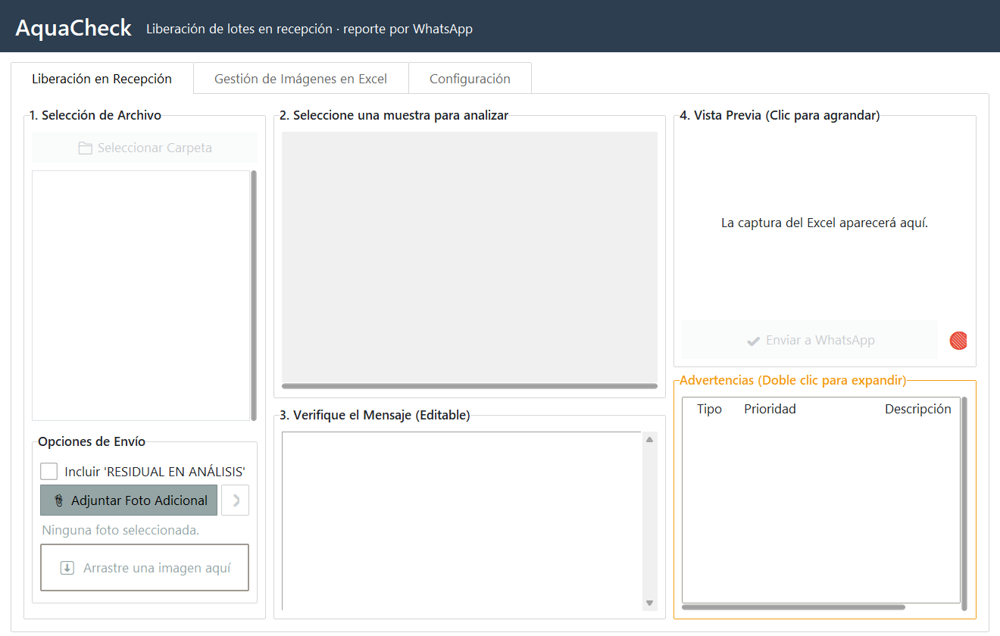

# AquaCheck · Liberación de lotes en recepción

Aplicación de escritorio que **revisa el análisis de recepción de cada lote de camarón** y prepara el reporte de liberación para el grupo de calidad: lee el Excel del laboratorio, marca los defectos fuera de límite, distingue lotes ASC y convencionales, toma la captura del análisis y la envía por WhatsApp con el mensaje listo.

La desarrollé en 2025 mientras trabajaba como Monitor de Calidad en una empacadora de camarón. **Versión de portafolio:** sin datos, registros, rutas ni claves de la empresa.



## Qué hace

- **Selección de archivo y muestra**: arrastras el Excel del día y eliges la muestra a liberar.
- **Validaciones antes de enviar**: datos obligatorios, color, sabor, lote contra la hoja, variación de gramaje y coherencia con lo ya enviado hoy (mismo lote con otro proveedor, misma piscina con otro lote).
- **Mensaje editable** con los defectos y una **captura del análisis** como imagen.
- **Envío por WhatsApp** (Green API) con control de duplicados.
- **Gestión de imágenes en Excel**: inserta las fotos de cada lote en su archivo.

## Tecnología

Python · Tkinter / ttkbootstrap · tkinterdnd2 (arrastrar y soltar) · openpyxl · pandas · Green API (WhatsApp)

## Cómo usarla

```bash
pip install -r requirements.txt
copy .env.example .env      # y completa los datos de tu instancia de Green API
python main_app.py
```

La configuración de carpetas se guarda en `%APPDATA%\AquaCheck\config.json`.

## Mejoras de esta versión

- **Interfaz renovada**: tema `flatly`, cabecera con el nombre de la app, tipografía Segoe UI, lista de archivos y zona para soltar fotos más claras, y barra de estado que ya no se sale de la ventana.
- **Error corregido**: cuando fallaba la vista previa o el envío, la ventana de error nunca aparecía (la variable del error ya no existía al mostrarla). Ahora se ve el mensaje real.
- **Sin datos sensibles**: claves de WhatsApp, rutas, registros y lotes reales fuera del código; el servidor de Green API se configura con `GREEN_API_HOST`.

---

**Autor: Roger Pillasagua**

- Correo: [rogerpillasagua95@gmail.com](mailto:rogerpillasagua95@gmail.com)
- WhatsApp: [+5999 692-5640](https://wa.me/59996925640)
- [Portafolio](https://rpillasagua95.github.io) · [LinkedIn](https://www.linkedin.com/in/rogerpillasagua)
